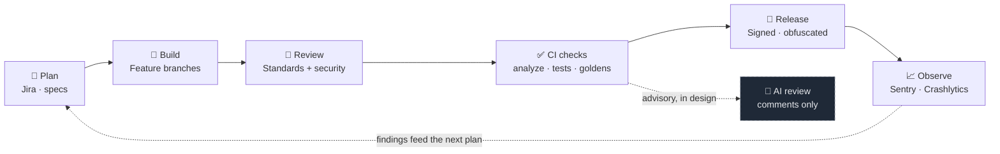
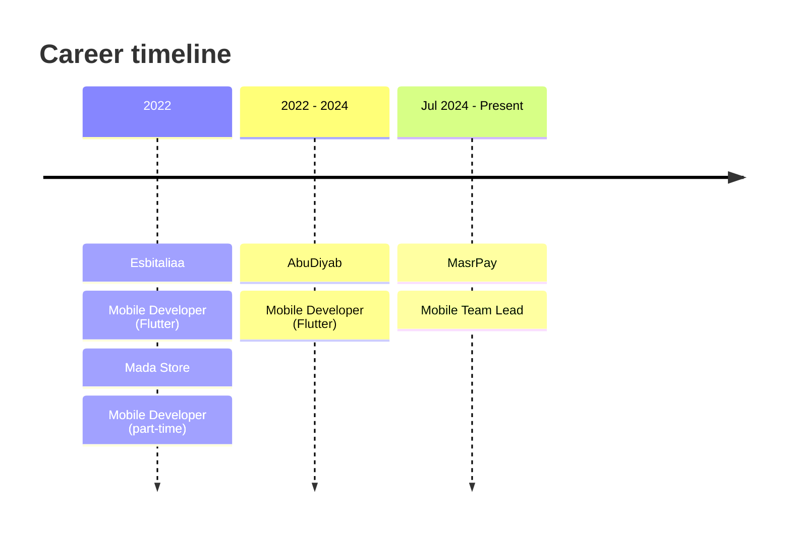

 

**Mobile Team Lead · Senior Flutter Engineer**
📍 Cairo, Egypt &nbsp;·&nbsp; 🌐 Arabic · English &nbsp;·&nbsp; 🎓 BSc Information Systems, GPA 3.67

 

---

## 👋 About

I build and lead the mobile apps at **MasrPay**, a bilingual digital wallet, and **TechTank**, a pay-at-the-pump fueling app. I work on payment features, mobile architecture, code review, CI and reliable releases, and I help developers grow into engineers who own their work.

Since 2022 I have shipped production Flutter apps for users in Egypt, Saudi Arabia and the UAE. Payments raise the stakes on every release, and that shapes how I work.

| | |
|---|---|
| 🎯 **Focus** | Flutter · FinTech · Delivery |
| 🧭 **Currently** | Leading mobile development at MasrPay |
| 📚 **Learning** | PMI-ACP (delivery track), Firebase Associate Developer |
| 🤝 **Open to** | Team lead roles, senior Flutter work, payment products, engineering automation |

---

## 📊 Impact at a glance

| 📱 **15+** | ⚡ **3.2s → 0.8s** | 🧪 **~860** | 🎓 **50+** | 👥 **5+** |
|:---:|:---:|:---:|:---:|:---:|
| Apps published Google Play · App Store · AppGallery | MasrPay cold start ~75% faster | Automated tests in CI TechTank, every push | Students trained Google Developer Student Clubs | Junior developers mentored to mid-level |

---

## 🏗️ How I deliver

A simple loop that every change goes through on my team. The AI review step is still in design.

**Principles I hold the pipeline to**

- **Validate early:** analyze and tests run on every pull request, not after the merge.
- **Humans own the merge:** automation informs a decision; a named reviewer makes it.
- **Script the release:** obfuscation, debug symbols and signing are enforced by the build.
- **Never retry money blindly:** reads retry with backoff; a payment is resent only when it provably never left.
- **Keep keys out of git:** secrets come from ignored files or build flags.

---

## 🧰 Tech stack

**Core, used in shipped products**

**Delivery & quality**

<b>Architecture, state management and more</b>

 

- **Architecture:** Clean Architecture · MVVM · Repository pattern
- **State:** BLoC / Cubit · GetX · GetIt (DI)
- **Networking:** Dio with interceptors · REST · Socket.IO · token refresh
- **Local data:** Hive (encrypted) · SQLite · secure storage
- **Security:** biometric auth · certificate pinning · PCI-DSS requirements · OWASP MASVS
- **Localisation:** gen-l10n · full Arabic RTL · golden tests in English and Arabic
- **Also working with:** Riverpod · Provider · OAuth 2.0 · JWT · GraphQL · Laravel · MySQL

---

## 🚀 Featured projects

### 💳 MasrPay User App · *FinTech · Shipped*

A digital wallet for the Egyptian market: send, request and receive money, pay bills and top-ups, pay community fees, top up through 10+ gateways and issue virtual cards.

- 🌍 Full Arabic RTL across **85 screens**, with mixed-direction text handled for amounts, IDs and phone numbers
- 🛡️ Checkout creates a server transaction only after the user confirms
- 🔍 Golden tests in both languages catch layout regressions before release
- 📉 **Sentry** crash and performance monitoring, **Shorebird** over-the-air patches, **Xcode Cloud** CI

`Flutter` `Dart` `GetX` `Clean Architecture` `Sentry` `Shorebird` `Xcode Cloud`

---

### 🚗 TechTank · *Mobility · Shipped*

A pay-at-the-pump app: find a station, navigate, pay from the wallet or card, start the pump from the phone, and watch litres and amount live.

- 🔁 Retries only for reads; payments are resent only when the connection never opened, with an idempotency key per action
- 📶 Connectivity states (online, slow, captive portal, offline) with an encrypted read-only cache that never becomes a second source of truth
- ⚡ Live fueling over **Socket.IO**; navigation keeps guiding in the background
- ✅ **~860 automated tests** and GitHub Actions on every push and pull request

`Flutter` `Cubit` `Dio` `Socket.IO` `Google Routes API` `FCM` `GitHub Actions`

---

### 🏦 MasrPay Platform · *FinTech · Shipped*

Clean Architecture with one BLoC per payment flow, so a failed transfer cannot leak into a running card payment.

- 📈 Cold start cut from **3.2 s to 0.8 s** with lazy loading, code splitting and profiling
- 🔐 Biometric authentication and end-to-end encryption for sensitive payment data
- 🔔 Real-time transaction status with FCM push and Firestore live updates

`Flutter` `BLoC` `Firebase` `FCM` `Firestore` `Crashlytics`

---

### 🚙 AbuDiyab Platform · *Mobility · Shipped*

A family of apps for a Saudi vehicle-rental company: customer rentals, live vehicle tracking, self-service rental automation and staff attendance.

- 📍 Live GPS tracking and route optimisation with Google Maps SDK
- 🔄 Firebase Realtime Database for bookings and availability, which prevents double bookings
- 📦 Four related apps (AbuDiyab, AbuDiyab GPS, 4GO, TS Finger) shipped on iOS and Android together

`Flutter` `Google Maps SDK` `Firebase Realtime DB` `FCM` `Hive`

---

## 💼 Experience

| Period | Role | Company | What I did |
|---|---|---|---|
| **Jul 2024 – Present** | Mobile Team Lead | **MasrPay** · Cairo | Owns mobile architecture; leads code review, standards and sprint delivery; mentors developers |
| **Aug 2022 – Jun 2024** | Mobile Developer (Flutter) | **AbuDiyab** · KSA (remote) | Owned the rental workflow: vehicle selection, GPS tracking, payment |
| **Jun 2022 – Apr 2024** | Mobile Developer (part-time) | **Mada Store** · Remote | Catalog, cart and checkout; local favourites with cloud sync |
| **2022 – 2024** | Mobile Developer (Flutter) | **Esbitaliaa** · Egypt, KSA, UAE | Patient app and Doctor app for a healthcare booking platform |

---

## 🎓 Education & certifications

**BSc Information Systems**, Future University in Egypt · 2017 – 2021 · GPA 3.67 / 4.0

| Certification | Status |
|---|---|
| Google Flutter Development Fundamentals | ✅ Completed |
| Mobile App Security Best Practices | ✅ Completed |
| Dart Programming Language | ✅ Completed |
| Firebase Associate Developer | 🔄 In progress |
| PMI Agile Certified Practitioner (PMI-ACP) | 📘 In preparation |

---

## 🧑‍🏫 Mentoring & community

- 🎯 **Flutter Instructor** at Google Developer Student Clubs: trained **50+** students in hands-on Flutter and C++ workshops
- 🧭 Supervised final-year graduation projects through to production-quality implementations
- 🗣️ Speaker at developer meetups on mobile development practice
- 🏛️ Internal workshops at MasrPay on Flutter architecture, BLoC, Clean Architecture and mobile security

---

## 📬 Let's connect

I'm open to team lead roles, senior Flutter and mobile engineering, payment products, CI/CD and engineering automation, and freelance or consulting projects.

 

📈 **Profile views** &nbsp;·&nbsp; 

Built with care in Cairo · Shipping payments, one reviewed change at a time.

